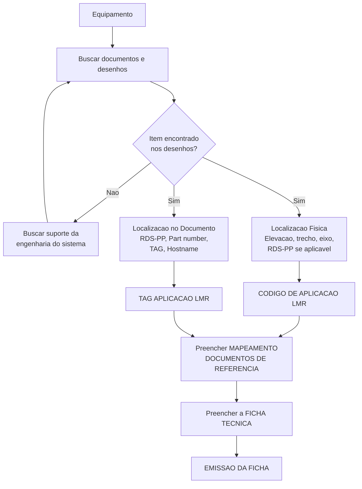

# Seção — Aplicação LMR

> [!info] Padrão v1.4 e automação (23/10/2026)
> O formato do CÓDIGO e da TAG LMR foi unificado para todas as aplicações — regras em
> [[Aplicacao LMR - Regras de Montagem]]. Os exemplos do RTA abaixo são do formato antigo.
> A planilha passou a ser gerada por regra no n8n do AMP: [[Plano - Automacao da Aplicacao LMR no AMP]].

> [!success] Critério fechado em 31/08/2026
> **Itaipu aceitou o modelo do CMI.** A discussão de template acabou; o que resta e
> executar. Ver [[Revisao da Aplicacao LMR - Agosto 2026]].

> [!warning] Contínua sendo o gargalo — agora de capacidade
> 1. **É o menor indicador da cadeia** — a seção que menos avança em relação ao total de
>    fichas existentes.
> 2. **Há fichas emitidas a Itaipu sem a LMR completa** — o passivo que originou o plano
>    de ação.
> 3. **Não tem lastro na ET.** Ver [[ET Geral 6047-20-T0018]] — o que importa menos
>    agora que o critério esta acordado, mas segue valendo registrar.
>
> O universo esta levantado em [[Levantamento - Fichas sem Aplicacao LMR]].

## O que e

Do slide 18 da apresentação R5:
> Processo de **identificar e documentar a localização de cada equipamento dentro da
> usina**, usando desenhos técnicos, e **codificar essa localização** para inserção no
> portal PMIB.

Traduzindo: a Aplicação LMR responde **"onde, dentro do projeto, este sobressalente
pode ser aplicado?"**.

## A regra de escopo que evita trabalho infinito

> [!important] Uma ficha, um sistema
> A Aplicação LMR e feita **apenas para o sistema a que a ficha pertence**.
> Se um switch também cabe no rack de outro sistema, **isso é ignorado**.
> Sem essa regra o trabalho seria combinatorio.
>
> O custo dessa regra: o mesmo material em dois sistemas vira duas fichas, e cada uma
> tem a sua LMR. Ver [[Fichas Duplicadas]] — o procedimento e explicito de que a LMR da
> duplicada e a da **nova** lista, não copia da original.

## Responsabilidade

**E da GE / CMI, não do fornecedor.** O fornecedor não tem os desenhos do projeto.
Ver [[Atores e Areas]].

## O fluxo (slide 18)



O passo zero, antes de tudo: **criar o Mapeamento de Documentos de Referência** da
lista.

## Os dois campos que vao ao portal

### CÓDIGO DE APLICAÇÃO LMR — a localização física
Sistema — tipo de equipamento — local — elevacao; eixo; trecho.

Exemplos reais (RTA):
```
RTA - ACCESS POINT - CASA DE FORCA - ELEV. 108; EIXO B-C; TRECHO U18A
RTA - ACCESS POINT - BARRAGEM PRINCIPAL - ELEV. 214; EIXO BP; TRECHO F1/2
RTA - TELEFONIA E VIDEO CONFERENCIA - #ST60=Y01YAA15
```

Quando o equipamento e acessorio de outro (uma antena de um access point), o código
referência o equipamento pai pelo RDS-PP:
```
RTA - C9124AXE-ROW - RDS-PP: #ITA0=Y01YCQ11KF111-KF001 - CASA DE FORCA - ELEV. 108; EIXO B-C; TRECHO U18A
```

### TAG DE APLICAÇÃO LMR — a identificação no documento
TAG do equipamento + RDS-PP + descrição entre parenteses.

```
AP01-UTA1.25 / RDS-PP: #ITA0=Y01YCQ11KF111-KF001 (ACCESS POINT INDUSTRIAL 9124AX - DIRECIONAL - 01 )
RDS-PP: #ITA0=Y01YAA15TF141-TF002 (CISCO CP7821 - TELEFONE IP FIXO USO GERAL - 02 )
ANTENA AIR-ANT2588P3M-N=
```

Ver [[RDS-PP e KKS]].

## O template

`Box/15 - PDM/Templates/APLICACAO LMR - SOBRESSALENTES_template.xlsx` — 4 abas:

### Aba `DOCS DE REFERENCIA`
Cabeçalho da lista:
- `LISTA DE SOBRESSALENTE:` (ex.: `#ITA0=Y01TF001&BPB020`)
- `LISTA DE DOCUMENTOS:` *(pedido de Itaipu em 20/08/2026 — ainda em branco)*
- `WORKSTATEMENT` *(idem)*
- `ESPECIFICACAO TECNICA / CAPITULO:` · `SUBSISTEMA:`

Tabela — uma linha por (material x documento):

| CÓDIGO PMIB | PART NUMBER | DESCRIÇÃO DO MATERIAL | RDS-PP DOCUMENTO - PRINCIPAL | QTD | COMENTÁRIOS |
|---|---|---|---|---|---|

### Aba `DESCRICAO DOCUMENTOS`
Amarra os três códigos de cada desenho:

| CÓDIGO ITAIPU | CÓDIGO CMI | DESCRIÇÃO DOCUMENTO |
|---|---|---|
| `#ST50=Y01YCQ10-UH001&ETC010` | `0893410CYU20-220FTL-56` | ATUALIZAÇÃO TECNOLÓGICA - PAT_OBJ1 - ENG. ELÉTRICA - CASA DE ... |

### Aba `APLICACAO - LMR`
O que efetivamente sobe ao portal:

| FICHA_PMIB | CODIGO_LMR | TAG_LMR | Status |
|---|---|---|---|

### Aba `EXEMPLO APLICACAO LMR DO RTA`
Referência de preenchimento — **8.557 linhas para 57 fichas**.
Uma média de ~150 pontos de aplicação por ficha. Este número e o melhor
dimensionador de esforço que existe no projeto.

## O que o modelo aceito exige

Da [[Revisao da Aplicacao LMR - Agosto 2026]], **acordado**:
1. **Quantidade** de unidades aplicadas por equipamento.
2. **Uma linha por ponto de aplicação** — não agregar.
3. Coluna com o **código de Emissor** do documento principal.
4. Colunas para **documentação adicional** (informações dimensionais de projeto e
   diagramas funcionais).
5. **Workstatement + Lista de Documentos** no cabeçalho (campos já existem, vazios).

## Automação no SIG-FT

Dois módulos:
- **Cadastro LMR** (`lmr_backend`) — lê a aba `GERAL` (PMIB, Codigo_PMIB, TAG_PMIB),
  **agrupa TAGs consecutivas por código**, navega até a ficha e preenche Equipment
  Code, Quantity Installed e Tag. Erros vao para `erros_lmr.csv`.
- **Apagar LMR** (`apagar_lmr_backend`) — exclusão em massa das aplicações de uma ficha.
  Existe porque **refazer a LMR e mais rapido que corrigir linha a linha**, e porque
  a mudança de critério obriga refazer.

> [!tip] O módulo "Apagar LMR" muda de papel
> Ele nasceu como remendo para um critério instável. Com o critério fechado, passa a ser
> ferramenta de correção pontual — e o volume de uso dele deveria cair.

### Geração da planilha no AMP (desde 23/10/2026)
A planilha de Aplicação LMR (as 3 abas do template) é gerada no n8n do AMP a partir da
**Base da Aplicação** — uma linha por material numa posição. O SIG-FT continua sendo quem sobe
ao portal. Ver [[Plano - Automacao da Aplicacao LMR no AMP]].

## Colunas de controle
- `_STATUS_PMIB`: coluna **`APLICACAO - LMR`**
- Mapeadora: coluna **`FICHAS COM APLICACAO - LMR FINALIZADA`**

## Relacionados
[[Revisao da Aplicacao LMR - Agosto 2026]] · [[Aplicacao LMR - Regras de Montagem]] · [[Plano - Automacao da Aplicacao LMR no AMP]] · [[RDS-PP e KKS]] · [[Diagnostico - Deficiencias]] · [[SIG-FT - Modulos]]
