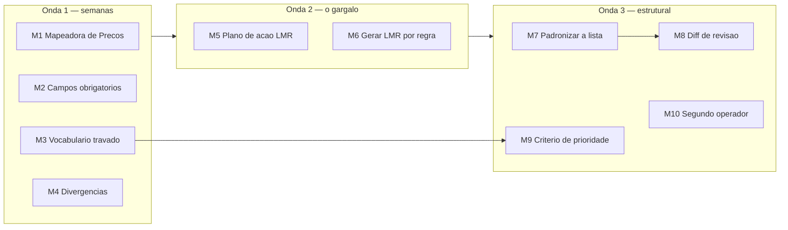

# Diagnostico — Plano de Melhoria

> [!warning] Documento de trabalho, nao conhecimento permanente
> Contem numeros e situacoes de uma data especifica. O que descreve **como o processo
> funciona** mora no nucleo do cofre (`01` a `06`).

Ações derivadas de [[Diagnostico - Deficiencias]] e [[Diagnostico - Riscos]],
ordenadas por **razão impacto/esforço**, não por gravidade.

---

## Onda 1 — barato e imediato

### M1. Mapeadora de Listas de Preços
**Resolve D2 · esforço baixo · impacto alto**

Replicar o que já funciona para as listas de sobressalentes. Uma aba ou planilha com,
por lista de sobressalentes:

| Campo | Por que |
|---|---|
| código da lista de sobressalentes | chave |
| código da lista de preços (código + sequencial) | identidade |
| revisão da lista de sobressalentes **a que a lista de preços se refere** | **o campo que hoje não existe em lugar nenhum** |
| revisão atual da lista de sobressalentes | comparar com o de cima |
| status Aconex · data de emissão | trilha |
| itens valorizados / itens da lista | cobertura |

**O ganho isolado mais importante**: comparar "revisão a que se refere" com "revisão
atual" acende automaticamente a **lista de preço defasada** — hoje invisivel.

Pode nascer como aba nova na mapeadora existente, aproveitando o módulo
[[SIG-FT - Modulos|Gestão PMIB]].

---

### M2. Fechar os campos vazios da mapeadora
**Resolve D6 · esforço baixo · impacto medio**

- **`RESPONSAVEL` obrigatório.** 37 listas sem responsável são 37 listas que ninguém
  esta puxando. E o campo mais barato de preencher e o de maior efeito gerencial.
- Trocar `ENTREGA` de campo-lembrete para **campo de data com status separado**.
  `Atualizar data` e `Informar data` são tarefas, não dados — deveriam viver na aba
  `Atividades Pendentes`.
- Validação no arquivo para impedir salvar linha nova sem responsável.

---

### M3. Travar o vocabulario de status
**Resolve D8 · esforço baixo**

1. Decidir a lista definitiva de `SITUACAO NO PMIB` (provavelmente a que se usa, não a
   do dropdown atual).
2. Atualizar a aba `Dropbox` e aplicar **validação de dados** na coluna.
3. Mapear os valores historicos para os novos, de uma vez.
4. Fazer o mesmo com a coluna `STATUS` do [[Planilha STATUS_PMIB]] contra a aba
   `Checklist`.

Sem isso, todo indicador por status carrega ruido.

---

### M4. Resolver as divergencias de fonte de verdade
**Resolve D12 · esforço baixo**

Uma nota por divergência, decidida e registrada:
- **Catalogo de PDM**: qual dos dois arquivos vale. Aposentar o outro para `0 - Obsoleto`.
- **Prazo de autorização**: confirmar 15 d.u. com Itaipu e **corrigir os slides antigos**
  da apresentação.
- **`ATRASO DE AUTORIZACAO`**: documentar se conta fichas ou dias.
- **README do SIG-FT**: remover a seção de fallback Selenium, que já não existe no código.
- **Dashboard `.pbix`**: confirmar a fonte e apontar para a mapeadora.

---

## Onda 2 — o gargalo

### M5. Plano de ação da Aplicação LMR
**Resolve D1 e R2 · esforço alto · impacto alto**

> Sessão dedicada. Registrado em [[progress]].

Sequência proposta:

**Passo 1 — levantar o universo.**
Cruzar, em todos os `_STATUS_PMIB`: coluna `APLICACAO - LMR` diferente de `COMPLETO`
**e** `DATA DO EMAIL COMUNICANDO ENTREGA` preenchida. São as fichas **já emitidas sem
LMR** — o passivo. E o insumo que falta hoje.

**Passo 2 — fechar o critério antes de escalar.**
Formalizar com Itaipu a resposta a [[Revisao da Aplicacao LMR - Agosto 2026]]. Enquanto
"uma linha por ponto" não estiver decidido, cada LMR feita e retrabalho potencial (R1).

**Passo 3 — atacar por lista, não por ficha.**
A LMR depende do **Mapeamento de Documentos de Referência** da lista. Feito o mapeamento
de uma lista, as fichas dela saem em bloco. Priorizar listas com muitas fichas já em
análise em Itaipu.

**Passo 4 — apresentar o plano antes de ser cobrado.**
Levar o passivo levantado, o critério acordado e o cronograma. Chegar com o problema
mapeado muda a conversa.

---

### M6. Reduzir o custo unitario da LMR

> [!success] Em execução desde 21/10/2026
> A planilha passou a ser gerada por regra no n8n do AMP (B rodando nos 5 sistemas de exemplo em
> 23/10). Falta a leitura dos documentos (workflow A). Ver [[Plano - Automacao da Aplicacao LMR no AMP]].
**Apoia M5 · esforço medio**

Com ~150 pontos de aplicação por ficha, o ganho está em **gerar, não digitar**:
- extrair TAG e RDS-PP diretamente dos desenhos/listas de equipamento do projeto, em
  vez de ler manualmente
- gerar `CODIGO_LMR` e `TAG_LMR` por regra a partir de (sistema, local, elevacao, eixo,
  trecho, RDS-PP, part number) — os padrões já são regulares, como se vê nos exemplos
  do RTA
- o módulo [[SIG-FT - Modulos|Cadastro LMR]] já **agrupa TAGs consecutivas**; o gargalo
  esta **antes**, na produção da planilha

---

## Onda 3 — estrutural

### M7. Padronizar a lista de sobressalentes na origem
**Resolve D3 e D4 · esforço medio · impacto contínuo**

O slide 21 já aponta a solução: **usar o mesmo template da lista de materiais**.
O que falta e torna-la condição de aceite.

Proposta:
1. Template único, com **linha de cabeçalho em posição fixa**.
2. Validador simples (script ou aba de conferencia) que a engenharia roda antes de
   emitir: colunas obrigatorias presentes, cabeçalho no lugar, códigos no formato certo.
3. Lista fora do padrão **volta** antes de virar `_STATUS_PMIB`.

**Ganho colateral no código**: elimina a razão de existir de ~10 implementacoes de
busca dinâmica de cabeçalho no SIG-FT.

---

### M8. Diff de revisão de lista
**Resolve D4 · esforço medio*

Quando o módulo Gestão PMIB detecta que uma lista mudou de revisão, gerar um **diff**
contra a versão anterior: itens que entraram, sairam, mudaram de quantidade ou de
marca/modelo. E marcar no `_STATUS_PMIB` os itens afetados.

Hoje o módulo já renomeia o arquivo pelo Tracking ID — falta comparar o conteudo.

---

### M9. Critério de priorização das fichas
**Resolve D5 · esforço baixo, decisão dificil**

O slide 19 pergunta *"quem indica a prioridade?"* e segue sem resposta. Enquanto isso,
57% das listas estão em `INICIAR` — várias delas já aprovadas pela engenharia.

Proposta de critério, para **o CMI levar pronto** em vez de esperar Itaipu decidir:

| Peso | Fator |
|---|---|
| alto | **evento de pagamento** associado esta próximo |
| alto | material já **entregue ou no almoxarifado do CMI** (D10 — libera estoque parado) |
| medio | lista com **`STATUS REAL = APROVADO`** (não ha risco de retrabalho por revisão) |
| medio | **número de fichas** da lista (ganho de escala por mapeamento de documentos) |
| baixo | complexidade do PDM |

Uma coluna `PRIORIDADE` calculada na mapeadora resolve a operação.

---

### M10. Segundo operador dos módulos de RPA
**Resolve R7 · esforço medio*

O SIG-FT tem um mantenedor principal. Treinar um segundo operador nos módulos que tocam
o portal e a mitigacao mais direta do bus factor. A `docs/base-conhecimento/` e o
`ROTEIRO_DE_TESTE.md` já existem para isso.

---

### M11. Tirar o controle do Excel
**Resolve R5 · esforço alto · não urgente**

Não e para agora, mas vale registrar o caminho: os `_STATUS_PMIB` e a mapeadora são um
banco de dados relacional disfarcado de planilha. Uma base real (SQLite compartilhado
ou SharePoint List) resolveria concorrencia, tipos e histórico de uma vez.

**Contra**: a equipe opera em Excel, o Box e o meio, e o SIG-FT inteiro esta construido
sobre `openpyxl`. **Não mexer antes de M1-M9.**

---

## Sequência sugerida

> [!tip] Se só der para fazer duas coisas
> **M1** (mapeadora de preços) e **M5 passo 1** (levantar o passivo de LMR).
> A primeira e barata e destrava a valorização. A segunda transforma o maior risco do
> processo em um número conhecido — e problema com número e problema gerenciavel.

## Relacionados
[[Diagnostico - Deficiencias]] · [[Diagnostico - Riscos]] · [[Secao - Aplicacao LMR]] · [[Lista de Precos]]
