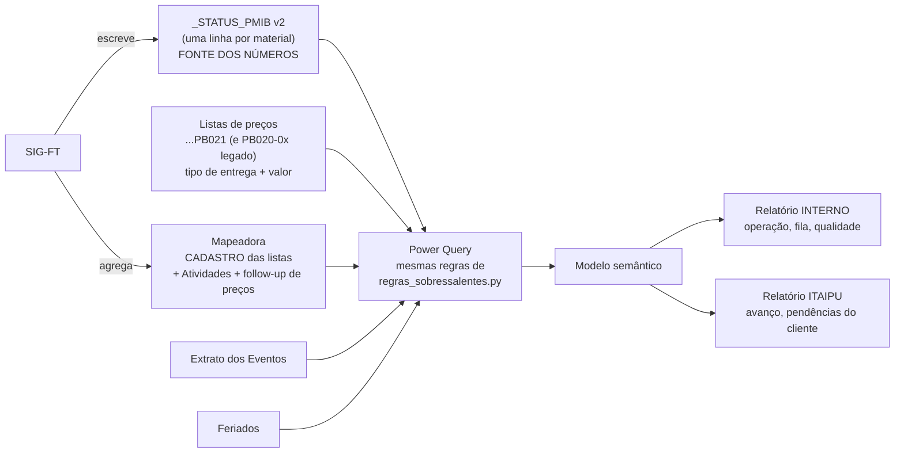

# Plano — Sistema de Gestão v2 dos Sobressalentes

> [!warning] Documento de trabalho, não conhecimento permanente
> Números de 01/10/2026. O que descreve **como o processo funciona** mora no núcleo do cofre (`01` a `06`).

> [!info] Em uma frase
> **O número nasce na ficha e vai direto para o painel.** O `_STATUS_PMIB` ganha as colunas que
> faltavam (tipo de entrega, procurement, datas da autorização e da entrega), a regra dos
> **15 dias úteis** passa a ser calculada — não digitada — e o Power BI deixa de depender das
> contagens da mapeadora, com duas visões: **interna** (operação) e **Itaipu** (cliente).

---

## 1. O que o levantamento de 30/09–01/10 mostrou

| Achado | Evidência | Consequência |
|---|---|---|
| O Power BI lê **uma tabela só**: a aba principal da mapeadora | `Sobressalentes - Dashboard.pbix`, consulta única, 4 medidas de soma | Nada abaixo do nível "lista": sem item, sem procurement, sem prazo, sem tipo de entrega |
| As contagens da mapeadora atrasam em relação às fichas | 4 listas com `FICHAS EXISTENTES` diferente do `_STATUS_PMIB` (ex.: Refrigeração QM903: 1 × 9) | Duas verdades na mesma reunião ([[Diagnostico - Riscos\|R8]] materializado) |
| O caminho da fonte está fixo numa máquina | `C:\Users\560083605\Box\...` | Só atualiza naquele computador |
| O SIG-FT ainda usa **14 dias corridos** | `sigft/services/pmib_manager.py` → `pd.to_timedelta(14, unit='D')`, também na versão mais nova do GitHub | O "atraso de Itaipu" da mapeadora está na regra antiga |
| `ATRASO DE AUTORIZAÇÃO` conta **fichas**, não dias | código do SIG-FT (PMIB distinto, sem duplicadas) | Fecha a dúvida registrada em [[findings]] |
| `APTO PARA ENTREGA` da mapeadora = apto **e ainda não entregue** | mesma função | A medida `AptoEntrega` do `.pbix` (apto − entregue) subtrai duas vezes |
| Tipo de entrega já existe — **na lista de preços** | coluna `TIPO DE ENTREGA` nas `...PB021` | 630 fichas sem lista de preços com a coluna = sem tipo |
| As listas suspensas do `_STATUS_PMIB` **somem** quando o SIG-FT salva | 21 planilhas têm a validação gravada como extensão (`Checklist!$A$3:$A$8`), que o openpyxl apaga | Por isso o vocabulário de status escapou do controle ([[Diagnostico - Deficiencias\|D8]]) |
| Template atual com nome definido errado | `dados_validos` → `A5:A11`, pula FICHA CRIADA e DUPLICADO; 32 nomes `#REF!` | Lista suspensa incompleta em arquivo novo |
| Lista de preços mudou de código | DCC **PB021** (revisão do ITAIPU-REF-0013) no lugar de `PB020-0x`; 9 PB021 já nas pastas, nenhuma na aba de follow-up | Detecção de lista de preço fica trivial pelo código (ver [[Lista de Precos]]) |

**O retrato de hoje** (1.355 fichas em 42 listas; 27 listas aprovadas ainda sem ficha):

| | |
|---|---:|
| Emitidas para Itaipu | 612 (45%) |
| Aprovadas | 64 |
| Pedidos de autorização pendentes | 195 — **53 além de 15 d.u.**, o mais antigo com 307 d.u. |
| LMR fora do compromisso de 3 meses | 269 |
| Seções concluídas — fornecedor | 55–68% |
| Seções concluídas — CMI | valorização 46% · **LMR 24%** |
| Material entregue | 379 fichas · US$ 1,35 mi de US$ 2,53 mi já valorizados |

---

## 2. A arquitetura

Três decisões estruturam o resto:

1. **A ficha é a fonte; a mapeadora é o cadastro.** Responsável, ET, revisão, eventos e
   observações continuam na mapeadora. Contagem sai do `_STATUS_PMIB`, item a item.
2. **Fato se digita; regra se calcula.** Datas e estados são digitados (ou carimbados por
   script). Prazo, situação e atraso são **sempre** calculados — no Excel para quem está
   trabalhando, no Power BI para quem está decidindo, com a mesma regra.
3. **Unidade = ficha** (código PMIB distinto, sem as linhas `DUPLICADO`), a mesma do SIG-FT.
   Linha não é ficha. `DUPLICADO` = o mesmo item repetido **na mesma lista** (repete o PMIB de
   outra linha; a quantidade conta no valor). A ficha duplicada **de outro sistema**
   (`PDM.9900.000`, PMIB da original em OBSERVAÇÕES) é ficha nova e conta.

---

## 3. `_STATUS_PMIB` v2

Nada que existe muda de nome ou de lugar — o SIG-FT lê por nome e a equipe não perde a
referência. As colunas novas entram num **bloco à direita** da tabela:

| Coluna nova | Quem preenche | Regra |
|---|---|---|
| **TIPO DE ENTREGA** | pré-preenchido pela lista de preços (818 linhas); o resto, quem cria a ficha | `FÍSICA E DOCUMENTAL` (sai na nota fiscal) · `DOCUMENTAL` (componente explodido, só ficha) · `TÍTULO` (conjunto) |
| **FORNECEDOR** | quem cria a ficha | empresa que vendeu ao CMI — não o fabricante |
| **PROCUREMENT** | pré-preenchido pela mapeadora quando a lista tem uma pessoa só (1.006 linhas) | lista suspensa que aceita nome novo |
| PRAZO AUTORIZAÇÃO ITAIPU (15 D.U.) | **SIG-FT** (valor) | data do e-mail + 15 dias úteis |
| **DATA DA AUTORIZAÇÃO ITAIPU** | e-mail de autorização — ou o script de aptos, com a data do export | substitui, com data, o "SIM" de `APTO PARA ENTREGA` (que fica, por compatibilidade) |
| SITUAÇÃO DA AUTORIZAÇÃO | **SIG-FT** (valor) | AGUARDANDO ITAIPU · ATRASADO ITAIPU · AUTORIZADO NO PRAZO · AUTORIZADO COM ATRASO · AUTORIZADO |
| DIAS ÚTEIS DE ATRASO | **SIG-FT** (valor) | além do prazo, até o cálculo ou até a autorização |

> [!important] Decisões de 04/10/2026
> Sem DATA DA ENTREGA (quase nunca se sabe); **nenhuma fórmula no Excel e nenhuma aba de feriados** —
> o SIG-FT calcula e grava quando roda; o arquivo é editado sem openpyxl, para não apagar comentários.
> Execução em [[Plano - Reestruturacao do STATUS_PMIB]].

Mais: os vocabulários das listas suspensas na aba **Checklist** (sem aba nova; o calendário de feriados fica no SIG-FT), e
**listas suspensas por nome definido** em STATUS, seções, APTO e ENTREGUE — esse tipo
sobrevive ao openpyxl do SIG-FT.

> [!important] Por que a data e não só o "SIM"
> Com o "SIM" se sabe **que** foi autorizado; com a data se sabe **quando** — e daí saem
> o prazo médio de Itaipu para autorizar, as autorizações que vieram com atraso e a curva de
> entregas que o cliente quer ver. O esforço é o mesmo: em vez de digitar SIM, digita a data.

### Tipo de entrega: por que precisa de coluna própria
A regra "código GE preenchido ⟺ FÍSICA E DOCUMENTAL" ([[Entrega Documental e Explosao de Itens]])
vale num sentido só: nenhum DOCUMENTAL tem código GE (259/259), mas **25 itens físicos estão
sem código GE** nas listas de preços da RV parte digital e do SMF. E 17 listas não têm `CÓDIGO CMI`
preenchido no `_STATUS_PMIB`. Derivar não é confiável — **declarar** é. A regra vira conferência.

---

## 4. As regras (uma só implementação de referência)

`_scripts/regras_sobressalentes.py` — e o Power Query de `_gestao_v2/powerbi/` repete as mesmas:

| Regra | Definição |
|---|---|
| Prazo de autorização | 15 dias úteis do e-mail de intenção; sábado, domingo e `Feriados` não contam |
| Atrasado Itaipu | e-mail enviado, sem autorização (nem APTO, nem data, nem entregue) e hoje > prazo |
| Compromisso LMR | LMR concluída em até 3 meses do e-mail; atenção a partir de 2 meses |
| Ficha emitida | STATUS em EM ANÁLISE IB · EM CORREÇÃO · APROVADO |
| Com quem está | CMI (iniciar, criada, elaboração, correção) · Fornecedor · Itaipu (análise) · Concluído |
| Pendência principal | correção → cobrar autorização → entregar material autorizado → LMR (se emitida) → fornecedor → valorização → LMR → emitir |
| PMIB | `4500063671.0000`; sem ponto ou numérico é corrigido na leitura (e listado em qualidade) |

Conferido: as fórmulas do template, recalculadas pelo LibreOffice, batem com a regra em
Python em 10 casos de teste e em 3 planilhas reais migradas (ex.: Inversores e PDE: 22
autorizadas + 32 atrasadas).

---

## 5. O painel — duas visões

O protótipo `_gerado/prototipo-dashboard.html` já mostra as duas, com os dados reais.

| Visão interna (CMI) | Visão Itaipu (cliente) |
|---|---|
| 6 cartões: fichas, emitidas, autorização atrasada, LMR fora do compromisso, material entregue (fichas e US$), pendências | 5 cartões: enviadas, em análise, aprovadas, material no almoxarifado, pedidos de autorização pendentes |
| Com quem está cada ficha, por área | Avanço das fichas por área (preparação → análise → aprovada) |
| Seções concluídas — fornecedor × CMI | Fichas enviadas ao longo do tempo |
| Autorização de Itaipu e compromisso LMR, por lista | Pedidos de autorização, com data do pedido e prazo |
| **Fila de trabalho** (a próxima ação de cada ficha), filtro por pendência e busca | Listas de preços aguardando a SM.DT |
| Listas de preços, **qualidade dos dados** (o plano de ação da aba Atividades saiu em 15/10/2026) | Situação por lista |

**Fora da visão do cliente:** nomes, procurement, observações, US$, fila, LMR, qualidade.
Roteiro de montagem: [[LEIA-ME|_gestao_v2/powerbi/LEIA-ME]].

---

## 6. O que já está pronto

| Entregável | Onde | Estado |
|---|---|---|
| Regras de negócio + leitura | `_scripts/regras_sobressalentes.py` | testado |
| Template `_STATUS_PMIB` v2 | `_gestao_v2/template/codigo_itaipu_STATUS_PMIB_v2.xlsx` | sem fórmulas; gerado pelo editor cirúrgico |
| Migração dos `_STATUS_PMIB` | `_gestao_v2/migrar_status_pmib_v2.py` + `xlsx_cirurgico.py` | simulada em cópias (04/10): 47/47 sem perda, comentários em thread intactos — não aplicada no Box. Execução em [[Plano - Reestruturacao do STATUS_PMIB]] |
| Consultas Power Query + medidas DAX | `_gestao_v2/powerbi/*.pq`, `05 - Medidas.dax` | escritas; montar no Desktop |
| Protótipo das duas visões | `_gerado/prototipo-dashboard.html` (`_scripts/gerar_prototipo_dashboard.py`) | gerado com dados de 01/10 |

> [!danger] A migração escreve no Box
> `--simular` trabalha em cópias locais. `--aplicar` altera os 47 arquivos **no lugar**,
> depois de copiar cada original para `%LOCALAPPDATA%\Sobressalentes-v2\backup_...`.
> Só rodar com o Box sincronizado, as planilhas fechadas e **autorização explícita**.

---

## 7. Sequência

**Semana 1 — instrumento**
1. Decidir as pendências da seção 8.
2. Rodar a migração (`--aplicar`) e trocar o template em `Templates/`.
3. Classificar o TIPO DE ENTREGA das 630 fichas sem lista de preços (começar pelas listas
   com material já entregue: RTA, Fire Fight, SMF…).
4. Corrigir na fonte o que a qualidade aponta: 169 fichas com STATUS N/A/vazio (Sala Segura),
   39 células de VALORIZAÇÃO com número, 9 cópias de trabalho na árvore.

**Semana 2 — painel**
5. Montar o modelo e o relatório interno no Power BI (roteiro no LEIA-ME).
6. Salvar a versão Itaipu e validar o texto com a gerência antes de mostrar ao cliente.

**Em paralelo — SIG-FT** (fora do Box, no repositório)
7. `pmib_manager.py`: trocar `pd.to_timedelta(14, unit='D')` por 15 dias úteis com feriados
   (a função `somar_dias_uteis` serve de modelo).
8. Script de aptos (`apto_para_entrega_att.py`): ao virar APTO = SIM, **gravar a DATA DA
   AUTORIZAÇÃO** com a data do export (`sobressalentes_autorizados_AAAAMMDDhhmm`).
9. Ao salvar com openpyxl, não recriar validação por referência a outra aba — usar os nomes
   definidos `lst_*`.
10. Atualizar a aba "Lista de preços Follow-up" para os códigos **PB021** e reconhecer lista de
    preço pelo DCC (PB021), mantendo PB020-0x como legado.

---

## 8. Decisões que são suas

| Decisão | Padrão adotado até decidir |
|---|---|
| Calendário dos 15 d.u.: só feriados nacionais do Brasil? Entram Paraguai, Foz, pontos facultativos? | nacionais BR + Carnaval e Corpus Christi |
| Mostrar a Itaipu "pedidos além de 15 d.u." | sim, com data do pedido e prazo — fato contratual |
| Mostrar valor (US$) ao cliente | não |
| Histórico das autorizações antigas (161 aptas sem data do e-mail) | ficam "AUTORIZADO" sem data; não reconstruir |
| Prioridade da fila: entregar material autorizado vem antes da LMR? | sim — dispara o evento de 80% |

## Relacionados
[[Plano - Dimensao de Tempo]] · [[Plano - Aba de Listas de Precos]] · [[Planilha STATUS_PMIB]] ·
[[Indicadores e Como Ler]] · [[Diagnostico - Deficiencias]] · [[Diagnostico - Plano de Melhoria]]
